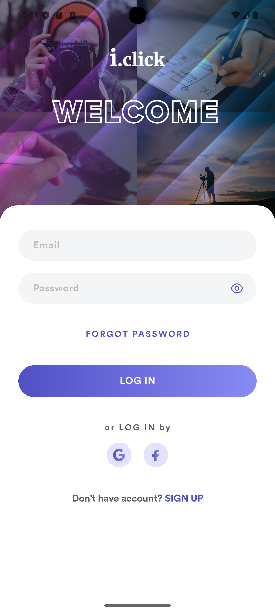
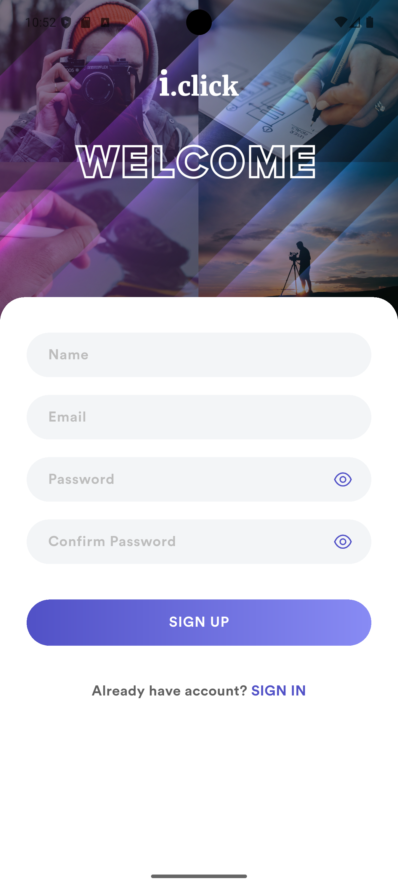
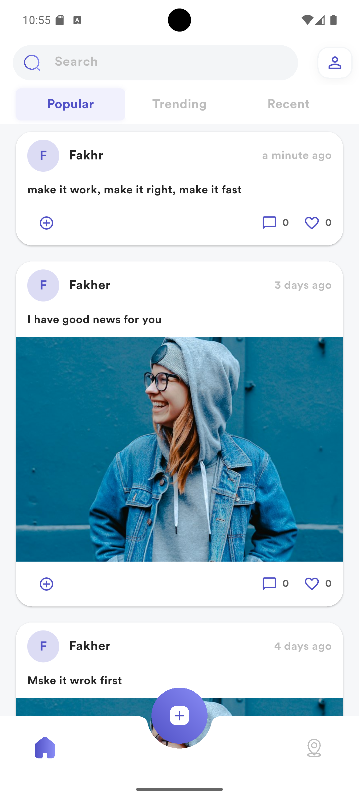
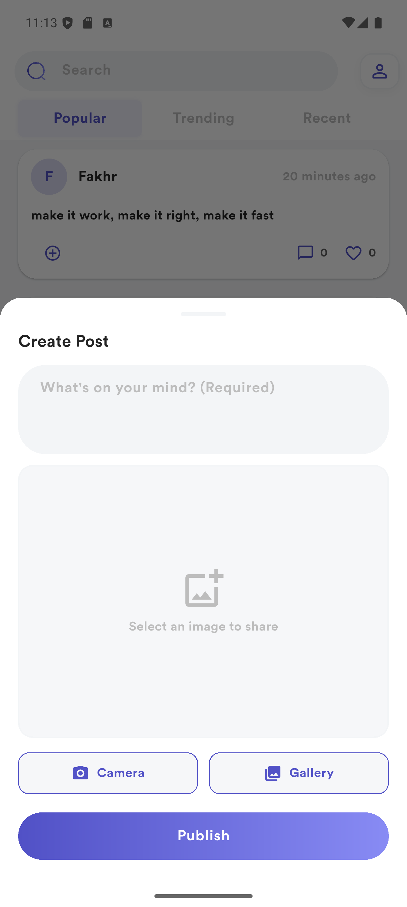
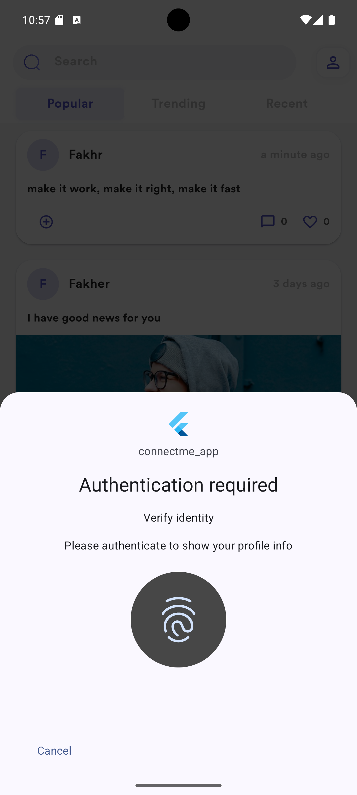
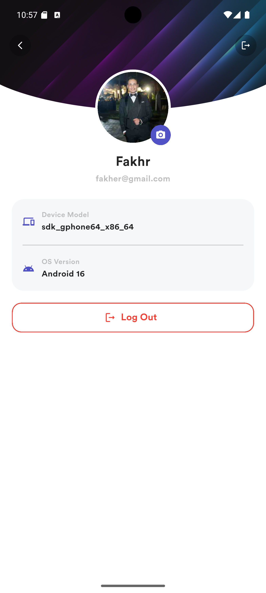
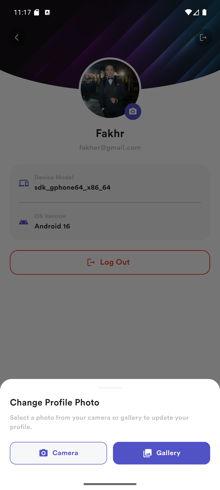
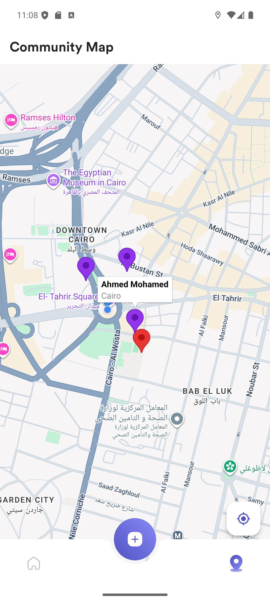

# ConnectMe Community App — Capstone Project

A production-ready, modular Flutter social community mobile application built as the Capstone project for the **American Center Cairo (ACC) & Sprints Flutter Training Program**.

Authored and Architected by **Omar Khalil**, Senior Mobile Engineering Lead.

The project demonstrates progressive native device capability integrations and cloud architecture: inspecting runtime device hardware specifications, selecting and uploading profile/post media from local storage and camera, integrating interactive full-screen Google Maps with custom markers pinned across Egyptian cities, securing user profiles with native biometric authentication, and managing real-time social community feeds via Firebase.

---

## 🏛️ Architecture & Design Patterns

The project strictly adheres to **Clean Architecture** principles and the **Dependency Inversion Principle (DIP)** to ensure testability, scalability, and loose coupling across layers.

### Clean Architecture Layers

```text
lib/
├── core/                           # Cross-cutting concerns & foundational utilities
│   ├── errors/                     # Domain Failure models (FirestoreFailure, UnexpectedFailure)
│   ├── utils/                      # AppColors, typography, gradients, and theme styles
│   └── widgets/                    # Reusable atom widgets (CustomGradientButton, CustomTextFormField, CustomAppDialog)
├── domain/                         # Pure Dart Business Logic Layer (Zero external dependencies)
│   ├── entities/                   # Immutable core business entities (User, Post)
│   ├── repositories/               # Abstract repository contracts (PostRepository)
│   └── usecases/                   # Single-responsibility use cases (GetPostsUseCase, CreatePostUseCase)
├── data/                           # Data Access & Persistence Layer
│   ├── datasources/                # PostDatasource interface, FirestorePostDatasource, LocalPostDatasource, Factory
│   ├── models/                     # Data models with JSON serialization (UserModel, PostModel, UserBuilder)
│   └── repositories/               # Concrete repository implementations (PostRepositoryImpl)
├── presentation/                   # UI & User Interaction Layer
│   ├── blocs/                      # State management Cubits & States (AuthCubit, PostCubit, ProfileCubit)
│   ├── screens/                    # Orchestrator screens (LoginScreen, SignUpScreen, HomeScreen, FeedsScreen, MapScreen, ProfileScreen)
│   └── widgets/                    # Reusable UI components (PostCard, CategoryTabs, CreatePostBottomSheet, DeviceInfoTile)
└── services/                       # Standalone native hardware and backend services
    ├── auth_service.dart           # Firebase Authentication wrapper
    ├── biometric_service.dart      # LocalAuthentication gatekeeper
    └── firestore_service.dart      # Singleton Cloud Firestore service
```

### Enterprise Design Patterns Applied

- **Singleton Pattern**: Applied to `FirestoreService` (`lib/services/firestore_service.dart`) to maintain a single, shared database instance throughout the application lifecycle, avoiding redundant network connections and ensuring centralized data access.
- **Builder Pattern**: Applied to `UserBuilder` (`lib/data/models/user_model.dart`) for fluent, step-by-step construction of the `UserModel` during sign-up without constructor pollution, allowing hardware details (`deviceModel`, `osVersion`) and profile pictures to be attached asynchronously.
- **Factory Pattern**: Applied to `PostDatasourceFactory` (`lib/data/datasources/post_datasource_factory.dart`) to cleanly instantiate the appropriate data source (`remote Firestore` vs `local cache`) via `PostDatasourceType { remote, local }`, decoupling repositories from concrete datasource implementations.

---

## 📱 Features by Module

### Module 1 — Authentication & Session Management
- **Strict Client-side Validation**:
  - Full Name requires a capitalized first letter (`^[A-Z]`).
  - Email address requires valid email format (`@` and domain).
  - Password requires a minimum of 6 characters.
  - Confirm Password requires exact match with password.
- **Firebase Authentication**: User registration and login backed by Firebase Auth.
- **Session Persistence**: Automatic splash check retaining authenticated users across application restarts.
- **Secure Logout**: Sign out flow with custom confirmation dialog (`CustomAppDialog`) and session clearance.

### Module 2 — Real-time Community Feed & Content Creation
- **Live Firestore Streams**: Reactive stream listeners updating the feed instantly when new posts are authored.
- **Category Filtering**: Interactive horizontal tabs (`Popular`, `Trending`, `Recent`) dynamically filtering posts in real-time.
- **Rich Post Cards**: Displays author image/avatar, publication timestamp formatted with `timeago` (e.g., *"3 days ago"*), caption text, attachment photos, and like/comment counters.
- **Create Post Bottom Sheet**: Floating Action Button opening a custom modal (`CreatePostBottomSheet`) with photo attachments from camera/gallery and immediate Firestore publishing.

### Module 3 — Biometric Gate & Hardware Profile
- **Native Biometric Gate**: Profile access is securely guarded by native device biometrics via `local_auth`. Users must authenticate with Fingerprint / Touch ID or Face ID to inspect the profile.
- **Runtime Device Hardware Introspection**: Dynamically queries host device specs using `device_info_plus`:
  - **Android**: Retrieves device manufacturer, brand, model, and OS version / SDK level.
  - **iOS**: Retrieves device model, system name, and iOS version.
- **Base64 Profile Photo Updates**: Capture photos via camera or select from gallery using `image_picker`, encodes them into Base64 format, and persists updates to both Firestore and local state.

### Module 4 — Community Members Map & Geolocation
- **Full-Screen Interactive Map**: Powered by `google_maps_flutter` with custom top bar configured with the title **"Community Map"**.
- **Multi-City & Dynamic Member Markers**:
  - Hardcoded community markers pinned across major Egyptian cities (**Cairo**, **Alexandria**, and **Giza**).
  - Dynamic Firestore users pinned according to their real coordinates.
  - Interactive Info Windows displaying member full name and city upon marker tap.
- **GPS Positioning**: Automatically requests location permission, gets current device coordinates using `geolocator`, updates user latitude/longitude in Firestore, and centers the camera.
- **Re-center Floating Action Button**: Smoothly animates camera back to the current user's GPS position.

---

## 🔒 Permissions

### 🤖 Android — `android/app/src/main/AndroidManifest.xml`

| Permission | Feature / Module | Description |
| :--- | :--- | :--- |
| `INTERNET` | All Modules | Enables communication with Firebase Auth, Cloud Firestore, and Google Maps servers |
| `USE_BIOMETRIC` | Module 3: Profile | Authenticate user via native fingerprint or face biometric sensors |
| `ACCESS_FINE_LOCATION` | Module 4: Map | Precise GPS device coordinates for community member location pinning |
| `ACCESS_COARSE_LOCATION` | Module 4: Map | Approximate network-based location fallback |
| `CAMERA` | Modules 2 & 3: Media | Access device camera for capturing post attachments and profile photos |
| `READ_MEDIA_IMAGES` | Modules 2 & 3: Media | Access photo gallery on Android 13+ (API 33+) |

```xml
<manifest xmlns:android="http://schemas.android.com/apk/res/android">

    <uses-permission android:name="android.permission.INTERNET" />
    <uses-permission android:name="android.permission.USE_BIOMETRIC"/>
    <uses-permission android:name="android.permission.ACCESS_FINE_LOCATION" />
    <uses-permission android:name="android.permission.ACCESS_COARSE_LOCATION" />

    <application
        android:label="connectme_app"
        android:name="${applicationName}"
        android:icon="@mipmap/ic_launcher">
        
        <!-- Google Maps API Key -->
        <meta-data 
            android:name="com.google.android.geo.API_KEY"
            android:value="YOUR_GOOGLE_MAPS_API_KEY"/>
    </application>
</manifest>
```

---

### 🍎 iOS — `ios/Runner/Info.plist`

| Key | Feature / Module | Usage Description |
| :--- | :--- | :--- |
| `NSFaceIDUsageDescription` | Module 3: Profile | We use Face ID to let you view your profile. |
| `NSLocationWhenInUseUsageDescription` | Module 4: Map | ConnectMe requires your location to display your marker on the community map. |
| `NSCameraUsageDescription` | Modules 2 & 3: Media | ConnectMe requires access to the camera to let you take photos for your profile and posts. |
| `NSPhotoLibraryUsageDescription` | Modules 2 & 3: Media | ConnectMe requires access to the photo library to attach photos to posts and profile. |
| `UIBackgroundModes → location` | Module 4: Map | Receive location updates while the app is running. |

```xml
<dict>
    <!-- Module 3: Biometric Authentication -->
    <key>NSFaceIDUsageDescription</key>
    <string>We use Face ID to let you view your profile.</string>

    <!-- Module 4: Location & Background Modes -->
    <key>NSLocationWhenInUseUsageDescription</key>
    <string>ConnectMe requires your location to display your marker on the community map.</string>
    <key>UIBackgroundModes</key>
    <array>
        <string>location</string>
    </array>

    <!-- Modules 2 & 3: Media Access -->
    <key>NSCameraUsageDescription</key>
    <string>ConnectMe requires access to the camera to let you take photos for your profile and posts.</string>
    <key>NSPhotoLibraryUsageDescription</key>
    <string>ConnectMe requires access to the photo library to attach photos to posts and profile.</string>
</dict>
```

---

## 🛠️ Technologies & Packages

| Package | Version | Purpose |
| :--- | :--- | :--- |
| [`firebase_auth`](https://pub.dev/packages/firebase_auth) | `^6.7.0` | User authentication, token lifecycle, and session persistence |
| [`cloud_firestore`](https://pub.dev/packages/cloud_firestore) | `^6.10.0` | NoSQL real-time cloud database powering feed streams and user coordinates |
| [`firebase_core`](https://pub.dev/packages/firebase_core) | `^4.15.0` | Official Firebase initialization layer across platforms |
| [`flutter_bloc`](https://pub.dev/packages/flutter_bloc) | `^9.1.1` | Predictable state orchestration and reactive UI rebuilding |
| [`bloc`](https://pub.dev/packages/bloc) | `^9.2.1` | Underlying state management library powering all Cubits |
| [`get_it`](https://pub.dev/packages/get_it) | `^9.3.0` | Service locator for dependency injection across layers |
| [`dartz`](https://pub.dev/packages/dartz) | `^0.10.1` | Functional programming abstractions (`Either<Failures, T>`) |
| [`google_maps_flutter`](https://pub.dev/packages/google_maps_flutter) | `^2.18.2` | Interactive full-screen map rendering, markers, and info windows |
| [`geolocator`](https://pub.dev/packages/geolocator) | `^14.1.1` | Native GPS coordinate querying and runtime location permissions |
| [`local_auth`](https://pub.dev/packages/local_auth) | `^3.0.2` | Native biometric authentication (Fingerprint / Face ID) |
| [`device_info_plus`](https://pub.dev/packages/device_info_plus) | `^13.3.0` | Inspect runtime device hardware model and operating system version |
| [`image_picker`](https://pub.dev/packages/image_picker) | `^1.2.3` | Native camera capture and photo gallery picker |
| [`timeago`](https://pub.dev/packages/timeago) | `^3.7.1` | Format publication dates into human-readable relative timestamps |
| [`flutter_svg`](https://pub.dev/packages/flutter_svg) | `^2.3.0` | High-fidelity vector SVG asset rendering |
| [`cupertino_icons`](https://pub.dev/packages/cupertino_icons) | `^1.0.8` | iOS-style iconography |

---

## 🚀 Getting Started

### 1. Clone the repository

```bash
git clone https://github.com/FakhrElddin/connectme_app.git
cd connectme_app
```

### 2. Install dependencies

```bash
flutter pub get
```

### 3. Configure Google Maps API Key

Obtain a Google Maps API Key from the [Google Cloud Console](https://console.cloud.google.com/) with **Maps SDK for Android** and **Maps SDK for iOS** enabled.

- **Android**: Add your key to `android/app/src/main/AndroidManifest.xml`:
  ```xml
  <meta-data 
      android:name="com.google.android.geo.API_KEY"
      android:value="YOUR_ACTUAL_GOOGLE_MAPS_API_KEY"/>
  ```

### 4. Configure Firebase

Ensure your Firebase project has **Authentication** (Email/Password) and **Cloud Firestore** enabled. Generate configuration files with:
```bash
flutterfire configure
```

### 5. Run the application

```bash
flutter run
```

---

## 📸 Screenshots

### Authentication & Community Feed

| Login Screen | Sign Up Screen | Home Feed | Add Post Modal |
| :---: | :---: | :---: | :---: |
|  |  |  |  |

### Biometric Security, Profile & Community Map

<table style="width: 100%; table-layout: fixed;">
  <thead>
    <tr>
      <th width="25%" align="center">Biometric Prompt</th>
      <th width="25%" align="center">Profile & Device Info</th>
      <th width="25%" align="center">Change Profile Photo</th>
      <th width="25%" align="center">Community Map</th>
    </tr>
  </thead>
  <tbody>
    <tr>
      <td width="25%" align="center" valign="top">
        
      </td>
      <td width="25%" align="center" valign="top">
        
      </td>
      <td width="25%" align="center" valign="top">
        
      </td>
      <td width="25%" align="center" valign="top">
        
      </td>
    </tr>
  </tbody>
</table>
