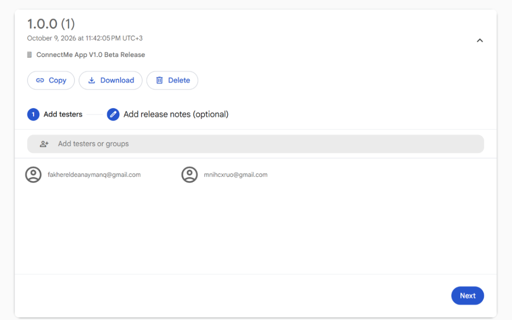
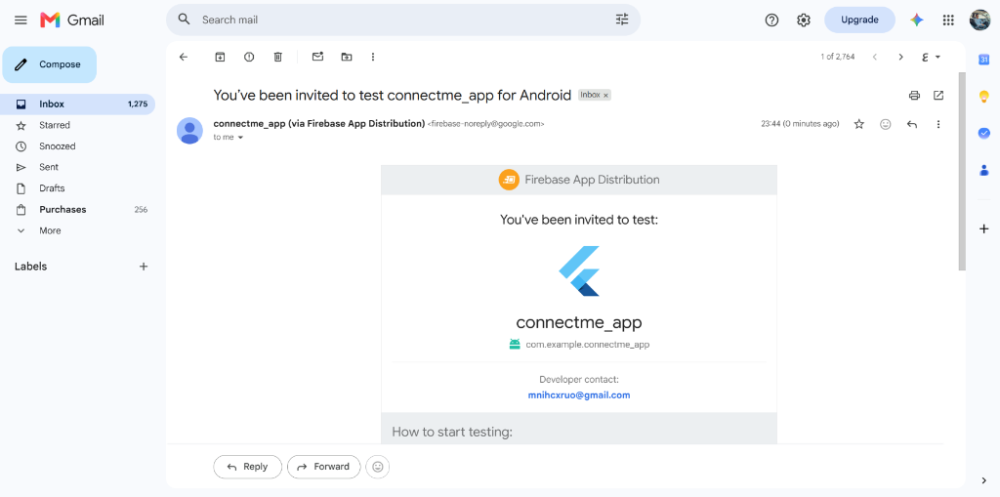

# ConnectMe Community App — Capstone Project

A modern Flutter social community application built as the Capstone project for the **American Center Cairo (ACC) & Sprints Flutter Training Program**.

---

## 🌟 Key Features

- **Authentication & Validation:** Sign Up, Login, and Logout backed by Firebase Auth with strict client-side validation and session persistence.
- **Real-Time Community Feed:** Live Firestore stream for posts, category filters, and a Floating Action Button to create posts with photos.
- **Biometric Security:** Profile access protected by native fingerprint / Face ID via `local_auth`.
- **Device Hardware Info:** Dynamically displays Device Model and OS Version via `device_info_plus`.
- **Profile Photo Update:** Pick photos from Camera or Gallery using `image_picker` and upload directly to Firestore.
- **Community Map:** Full-screen Google Map displaying members across Egyptian cities (Cairo, Alexandria, Giza) with interactive Info Windows (Name & City).
- **Beta Distribution:** Production APK built and distributed to testers via Firebase App Distribution.

---

## 🏛️ Architecture & Design Patterns

The project follows **Clean Architecture** (Data, Domain, Presentation) with **GetIt** for Dependency Injection and **Bloc/Cubit** for state management.

```text
lib/
├── core/           # Errors, colors, and reusable widgets
├── domain/         # Entities, repository contracts, and use cases
├── data/           # Data sources, models, and repository implementations
├── presentation/   # Cubits, screens, and custom widgets
└── services/       # Firebase, Biometric, and Native services
```

### Applied Design Patterns
- **Singleton Pattern:** Used in `FirestoreService` (`lib/services/firestore_service.dart`) to ensure a single shared database instance.
- **Builder Pattern:** Used in `UserBuilder` (`lib/data/models/user_model.dart`) for step-by-step construction of the `UserModel`.
- **Factory Pattern:** Used in `PostDatasourceFactory` (`lib/data/datasources/post_datasource_factory.dart`) to switch cleanly between remote Firestore and local cache.

---

## 🔒 Permissions

### Android (`AndroidManifest.xml`)

| Permission | Purpose |
| :--- | :--- |
| `INTERNET` | Firebase and Google Maps communication |
| `USE_BIOMETRIC` | Biometric fingerprint/face authentication |
| `ACCESS_FINE_LOCATION` | Precise GPS coordinates for Community Map |
| `ACCESS_COARSE_LOCATION` | Approximate location fallback |
| `CAMERA` | Taking photos for posts and profile picture |
| `READ_MEDIA_IMAGES` | Selecting photos from device gallery |

---

## 🛠️ Tech Stack & Packages

| Package | Purpose |
| :--- | :--- |
| `firebase_auth` & `cloud_firestore` | Authentication & Real-time database |
| `flutter_bloc` | State management |
| `get_it` | Dependency injection |
| `google_maps_flutter` & `geolocator` | Interactive map & GPS coordinates |
| `local_auth` | Native biometric authentication |
| `device_info_plus` | Hardware and OS version introspection |
| `image_picker` | Camera and gallery photo picker |
| `timeago` | Human-readable relative timestamps |

---

## 🚀 Getting Started

1. **Clone the repository:**
   ```bash
   git clone https://github.com/FakhrElddin/connectme_app.git
   cd connectme_app
   ```

2. **Install dependencies:**
   ```bash
   flutter pub get
   ```

3. **Add Google Maps API Key:**
   Add your key inside `android/app/src/main/AndroidManifest.xml`:
   ```xml
   <meta-data
       android:name="com.google.android.geo.API_KEY"
       android:value="YOUR_GOOGLE_MAPS_API_KEY"/>
   ```

4. **Run the app:**
   ```bash
   flutter run
   ```

---

## 📸 Screenshots

### 1. Application Screens

| Login Screen | Sign Up Screen | Home Feed | Add Post Modal |
| :---: | :---: | :---: | :---: |
|  |  |  |  |

| Biometric Prompt | Profile & Device Info | Change Profile Photo | Community Map |
| :---: | :---: | :---: | :---: |
|  |  |  |  |

---

### 2. Beta Release & App Distribution

| Firebase App Distribution Dashboard | Tester Invitation Email |
| :---: | :---: |
|  |  |
